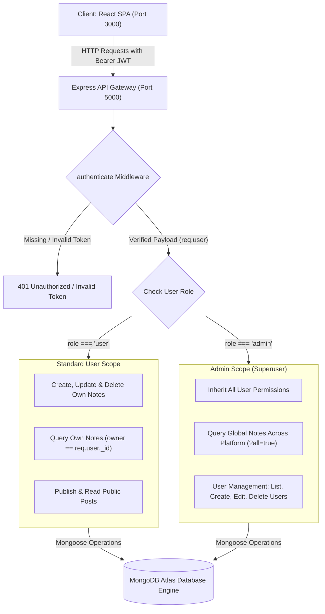
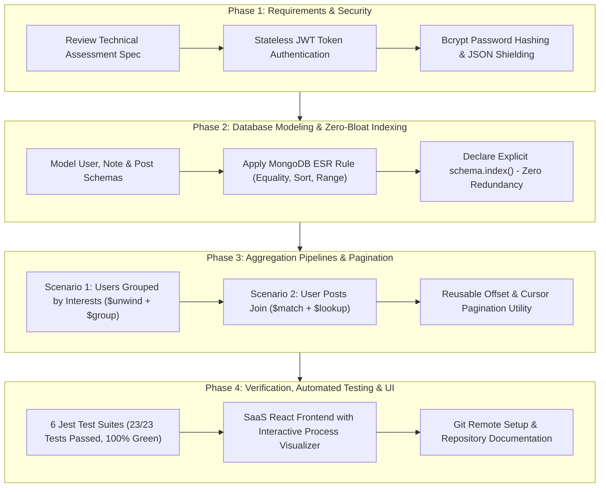
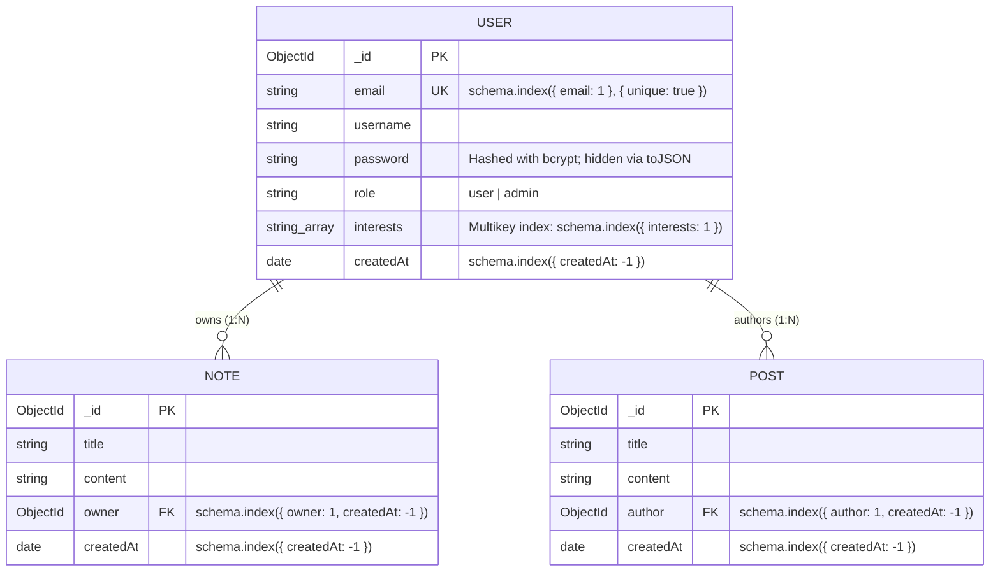
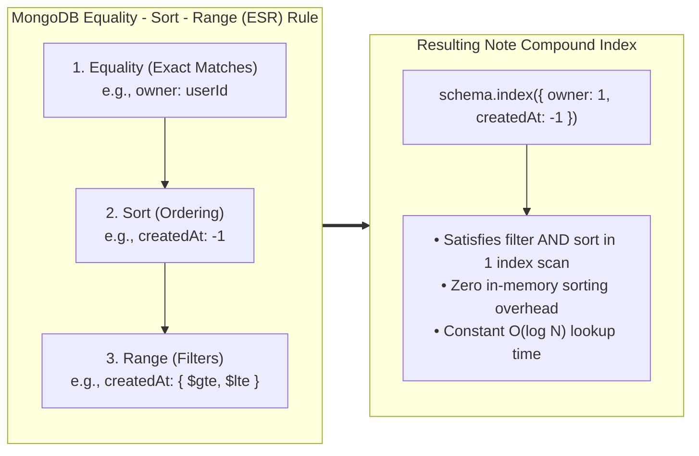
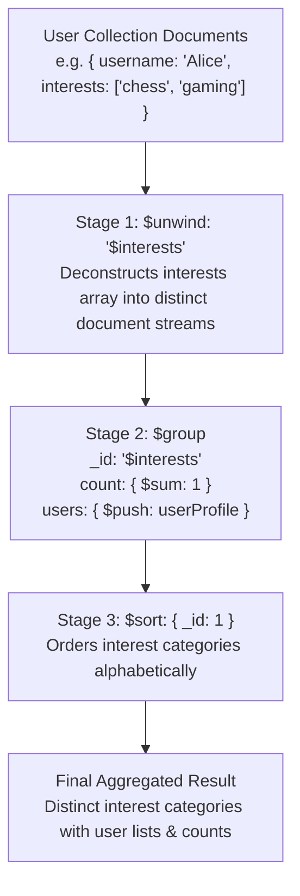
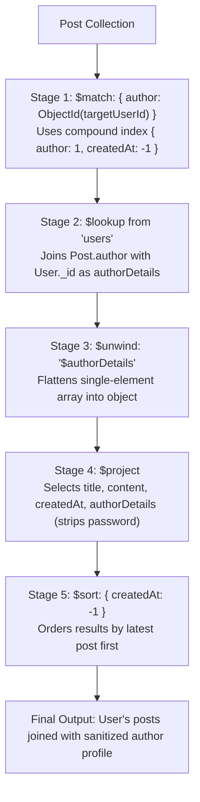
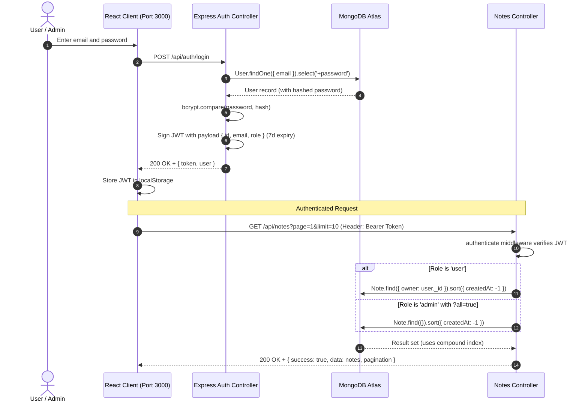
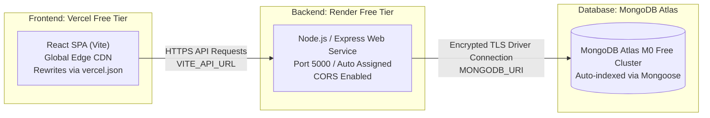

# Secure Notes Application

A clean, secure note-taking REST API and modern frontend built for the **Backend Developer Technical Assessment**. The project demonstrates secure authentication, role-based access control, zero-bloat database indexing via the ESR rule, and MongoDB aggregation pipelines.

### Live Deployments:
- **Live Frontend (Vercel):** [`https://notepad-assignment-coral.vercel.app/`](https://notepad-assignment-coral.vercel.app/)
- **Backend API (Render):** [`https://secure-notes-backend-gt01.onrender.com`](https://secure-notes-backend-gt01.onrender.com)
  - Health check: [`https://secure-notes-backend-gt01.onrender.com/health`](https://secure-notes-backend-gt01.onrender.com/health)
  - Aggregations Demo: [`https://secure-notes-backend-gt01.onrender.com/api/aggregations/group-by-interests`](https://secure-notes-backend-gt01.onrender.com/api/aggregations/group-by-interests)

---

## 1. System Architecture & Request Flow



---

## 2. The 4-Step Engineering Process



---

## 3. Database Entity-Relationship (ER) Diagram



---

## 4. Database Indexing Strategy (ESR Rule Visualized)

Every index was created for a specific query. Per the assessment rules, zero unnecessary or duplicate indexes exist.



### Complete Index Registry

| Collection | Defined Index (`schema.index`) | Query Supported / Performance Benefit |
| :--- | :--- | :--- |
| **User** | `{ email: 1 }` (`unique: true`) | Instant login lookup; enforces email uniqueness |
| **User** | `{ createdAt: -1 }` | Sorted pagination for admin user listing |
| **User** | `{ interests: 1 }` | Multikey index supporting interest filtering and Scenario 1 aggregations |
| **Note** | `{ owner: 1, createdAt: -1 }` | **ESR Rule**: Equality (`owner`) + Sort (`createdAt`) in a single B-tree traversal |
| **Note** | `{ createdAt: -1 }` | Sorted pagination when admin views all platform notes |
| **Post** | `{ author: 1, createdAt: -1 }` | Compound index supporting Scenario 2 `$match` + `$lookup` joins |
| **Post** | `{ createdAt: -1 }` | Sorted pagination for public community posts feed |
| **All Models** | `_id` (Primary Key) | Handled automatically by MongoDB engine |

---

## 5. Aggregation Pipelines Flow

### Scenario 1: Group Users by Interests (Single Pipeline Call)



### Scenario 2: Retrieve User Posts with `$lookup`



---

## 6. Authentication & RBAC Security Flow



### Roles and Permissions Matrix

| Feature / Action | Standard User | Admin |
| :--- | :---: | :---: |
| Create, edit, and delete personal notes | Yes | Yes |
| View own notes with pagination | Yes | Yes |
| View everyone's notes across the platform (`?all=true`) | No | Yes |
| Manage users (Add, Edit, Delete, List) | No | Yes |
| Write and view public posts | Yes | Yes |
| Run Scenario 1 Aggregation (Group by Interests) | Yes | Yes |
| Run Scenario 2 Aggregation (User Posts via `$lookup`) | Yes | Yes |

---

## 7. Quick Setup and Running Instructions

### 1. Prerequisites
- **Node.js:** v18.0.0 or higher
- **npm:** v9.0.0 or higher
- **MongoDB:** MongoDB Atlas connection string or local MongoDB instance

### 2. Install Dependencies
From the project root:
```bash
npm run install:all
```

### 3. Environment Setup
The backend reads credentials from `backend/.env` (which is kept private and excluded from git):
```env
PORT=5000
NODE_ENV=development
MONGODB_URI=your_mongodb_connection_string
JWT_SECRET=supersecretjwtkey_for_backend_interview_task
```
*(Reference: see `backend/.env.example`)*

### 4. Populate Database with Demo Data
Run the seed script to create test accounts, notes, and posts:
```bash
npm run seed:backend
```

**Pre-seeded Accounts:**
- **Admin Account:** `admin@example.com` / `password123` (Full permissions)
- **Standard User 1:** `alice@example.com` / `password123` (Standard permissions)
- **Standard User 2:** `bob@example.com` / `password123` (Standard permissions)

### 5. Start the Application
- **Backend API:**
  ```bash
  npm run start:backend
  ```
  Runs at **`http://localhost:5000`**.

- **Frontend Client:**
  ```bash
  npm run start:frontend
  ```
  Runs at **`http://localhost:3000`**.

### 6. Run Automated Tests
```bash
npm run test:backend
```

---

## 8. Free-Tier Deployment Guide (Render + Vercel)

This application is architected to deploy seamlessly onto free-tier cloud platforms.



### Step 1: Deploy Backend to Render (Free Web Service)

1. Sign in to [render.com](https://render.com).
2. Click **New +** $\rightarrow$ **Web Service**.
3. Select your GitHub repository: `emonislive/notepad-assignment`.
4. Configure service settings:
   - **Name:** `secure-notes-backend` (or any unique name)
   - **Branch:** `main`
   - **Root Directory:** `backend`
   - **Runtime:** `Node`
   - **Build Command:** `npm install`
   - **Start Command:** `npm start`
   - **Instance Type:** `Free`
5. Under **Environment Variables**, add:
   - `NODE_ENV`: `production`
   - `PORT`: `5000`
   - `MONGODB_URI`: `<your MongoDB Atlas connection string>`
   - `JWT_SECRET`: `<a secure random string>`
6. Click **Deploy Web Service**.
7. Once deployed, copy your Render URL (e.g. `https://secure-notes-backend.onrender.com`).

> [!NOTE]
> Render free-tier instances spin down after 15 minutes of inactivity and take ~30–50 seconds to wake up on the first incoming request. The frontend includes built-in retry messaging to handle cold starts gracefully.

---

### Step 2: Deploy Frontend to Vercel (Free Hobby Tier)

1. Sign in to [vercel.com](https://vercel.com).
2. Click **Add New...** $\rightarrow$ **Project**.
3. Import your GitHub repository: `emonislive/notepad-assignment`.
4. In the Project Configuration screen:
   - **Framework Preset:** `Vite`
   - **Root Directory:** Click **Edit** and choose `frontend`
   - **Build Command:** `npm run build`
   - **Output Directory:** `dist`
   - **Install Command:** `npm install`
5. Expand **Environment Variables** and add:
   - **Key:** `VITE_API_URL`
   - **Value:** `https://your-backend-app.onrender.com` *(paste your Render backend URL from Step 1)*
6. Click **Deploy**.
7. Your frontend will be live on a `*.vercel.app` domain with instant HTTPS and SPA routing pre-configured via `vercel.json`.

---

## 9. Automated Test Results

```
PASS tests/schema-indexing.test.js
PASS tests/api-routes.test.js
PASS tests/security-models.test.js
PASS tests/auth-rbac.test.js
PASS tests/aggregations.test.js
PASS tests/pagination.test.js

Test Suites: 6 passed, 6 total
Tests:       23 passed, 23 total
Snapshots:   0 total
Time:        4.898 s
```

---

## 10. API Endpoints Reference

### Authentication
- `POST /api/auth/register` - Create account (`username`, `email`, `password`, `role`, `interests`)
- `POST /api/auth/login` - Authenticate and get JWT token
- `GET /api/auth/me` - Get profile of current user (Requires Bearer token)

### Notes
- `GET /api/notes?page=1&limit=10` - List own notes with pagination
- `GET /api/notes?page=1&limit=10&all=true` - List all notes across system (Admin only)
- `POST /api/notes` - Create a new note
- `GET /api/notes/:id` - Fetch single note
- `PUT /api/notes/:id` - Update note
- `DELETE /api/notes/:id` - Delete note

### User Management (Admin Only)
- `GET /api/users?page=1&limit=10` - List all users with pagination
- `POST /api/users` - Add a new user
- `GET /api/users/:id` - Fetch user details
- `PUT /api/users/:id` - Update user or role
- `DELETE /api/users/:id` - Remove user (cascades associated data)

### Community Posts
- `GET /api/posts?page=1&limit=10` - List all public posts with pagination
- `POST /api/posts` - Create public post
- `GET /api/posts/:id` - Fetch single post

### Aggregations
- `GET /api/aggregations/group-by-interests` - Scenario 1: Group users by interests
- `GET /api/aggregations/user-posts/:userId` - Scenario 2: Retrieve user posts with `$lookup`
